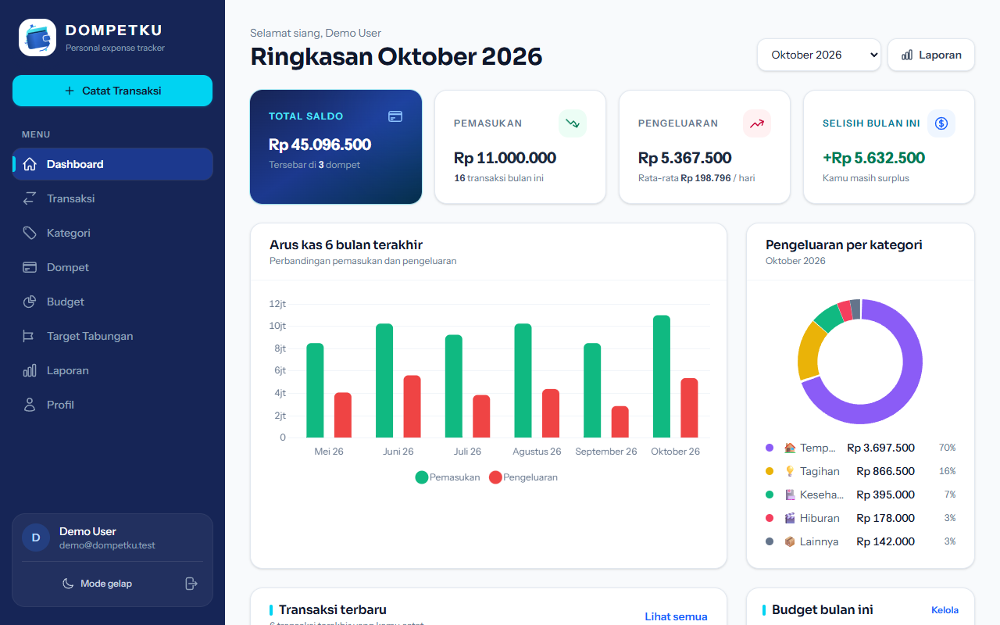
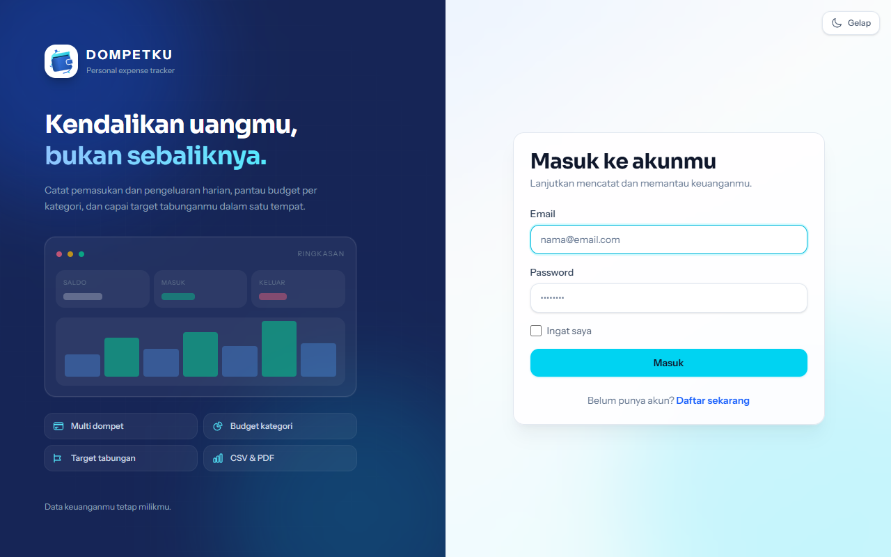
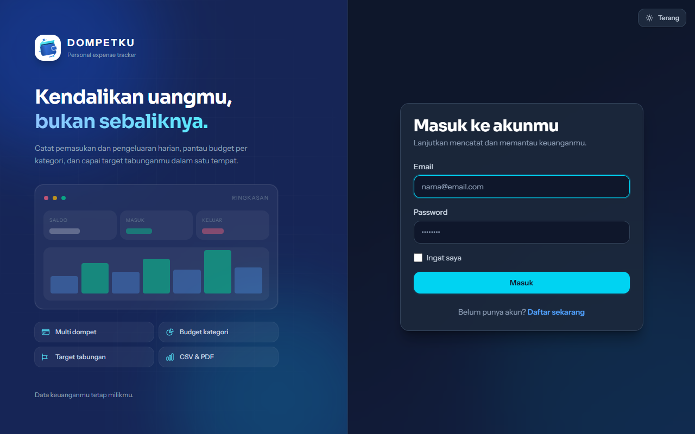

# Dompetku — Aplikasi Pelacak Keuangan Pribadi

Aplikasi web berbasis **Laravel 13** untuk mencatat pemasukan dan pengeluaran harian, memantau saldo bulanan, mengatur budget per kategori, dan mengejar target tabungan. Dibuat untuk memenuhi tugas mata kuliah **Web Programming D**.

## Fitur

1. **Dashboard keuangan** — total saldo seluruh dompet, pemasukan/pengeluaran bulan berjalan, selisih, rata-rata pengeluaran harian.
2. **CRUD transaksi** — pemasukan & pengeluaran dengan kategori, dompet, tanggal, dan catatan.
3. **Filter & pencarian transaksi** — berdasarkan bulan, jenis, kategori, dompet, dan kata kunci pada catatan (dengan pagination).
4. **CRUD kategori** — kategori pemasukan/pengeluaran dengan ikon dan warna, dilindungi dari penghapusan jika masih dipakai.
5. **CRUD dompet (multi-wallet)** — tunai, bank, dan e-wallet dengan saldo awal serta saldo berjalan otomatis.
6. **CRUD budget per kategori** — batas pengeluaran bulanan, progress bar, status aman/hampir habis/melebihi budget.
7. **CRUD target tabungan (goals)** — target nominal, tenggat, progress, dan fitur setor dana.
8. **Laporan bulanan** — rekap pemasukan/pengeluaran, perbandingan dengan bulan lalu, breakdown per kategori dan dompet, grafik arus kas harian.
9. **Export laporan** — unduh laporan bulanan sebagai **CSV** (siap Excel) atau **PDF** berformat rapi.
10. **Profil pengguna** — ubah nama/email dan ganti password (verifikasi password lama).
11. **Mode gelap** — toggle terang/gelap di sidebar, tersimpan di `localStorage`, dan otomatis mengikuti preferensi sistem saat pertama kali dibuka. Grafik ikut menyesuaikan warna tema.

Autentikasi: **registrasi** (otomatis membuat 12 kategori dan 3 dompet default), **login** (dengan opsi "ingat saya" dan rate limiting), serta **logout**.

## Tampilan Aplikasi

<p align="center">
  
  
</p>

<p align="center">
  
  
</p>

## Skema Database

```
users ─┬─< categories ─┬─< transactions >── wallets
       │               └─< budgets
       ├─< wallets ────────< transactions
       ├─< transactions
       ├─< budgets
       └─< goals
```

| Tabel | Foreign key | Keterangan |
| --- | --- | --- |
| `categories` | `user_id → users.id` | Kategori pemasukan/pengeluaran milik user |
| `wallets` | `user_id → users.id` | Dompet dengan saldo awal |
| `transactions` | `user_id`, `wallet_id`, `category_id` | Transaksi; `category_id` nullable (`nullOnDelete`) |
| `budgets` | `user_id`, `category_id` | Unik per (`user_id`, `category_id`, `month`) |
| `goals` | `user_id → users.id` | Target tabungan |

Sebagian besar foreign key memakai `cascadeOnDelete` agar data turunan ikut terhapus saat user dihapus. Pengecualiannya adalah `transactions.category_id`, yang memakai `nullOnDelete` agar transaksi tetap tersimpan ketika kategori dihapus.

## Teknologi

- Laravel 13 + PHP 8.3
- Blade Template + Tailwind CSS 4 (Vite)
- Chart.js (disimpan lokal di `public/vendor/chart.umd.min.js`, tetap jalan offline)
- dompdf (export laporan PDF)
- SQLite (default Laravel, tanpa konfigurasi tambahan)
- PHPUnit (29 feature test)

## Menjalankan Aplikasi

Prasyarat: PHP ≥ 8.3, Composer, Node.js ≥ 20.

```bash
composer install
cp .env.example .env          # Windows: copy .env.example .env
php artisan key:generate
php artisan migrate --seed    # membuat database/database.sqlite + data demo
npm install
npm run build
php artisan serve
```

Buka <http://localhost:8000>.

### Akun Demo

| Email | Password |
| --- | --- |
| `demo@dompetku.test` | `password` |

Seeder membuat data 6 bulan terakhir (gaji, freelance, belanja, tagihan, dll.), 5 budget, dan 3 target tabungan sehingga dashboard, grafik, dan laporan langsung terisi.

## Struktur MVC

```
app/
├── Http/Controllers/
│   ├── Auth/{LoginController, RegisterController}.php
│   ├── DashboardController.php
│   ├── TransactionController.php
│   ├── CategoryController.php
│   ├── WalletController.php
│   ├── BudgetController.php
│   ├── GoalController.php
│   ├── ReportController.php
│   └── ProfileController.php
├── Models/
│   ├── User.php, Category.php, Wallet.php, Transaction.php, Budget.php, Goal.php
│   └── Concerns/BelongsToUser.php   ← global scope kepemilikan data
├── Services/DefaultDataService.php  ← kategori & dompet default user baru
└── Support/helpers.php              ← format Rupiah & tanggal Indonesia

resources/views/
├── layouts/{app,guest}.blade.php
├── dashboard.blade.php
├── transactions/, categories/, wallets/, budgets/, goals/, reports/, profile/, auth/
└── partials/icon.blade.php

database/
├── migrations/  (users, cache, jobs, categories, wallets, transactions, budgets, goals)
└── seeders/DatabaseSeeder.php

routes/web.php
```

## Keamanan Data

- Semua query model dibatasi lewat global scope `BelongsToUser`, sehingga user tidak bisa membaca/mengubah data milik user lain (route model binding otomatis 404).
- Validasi kepemilikan `wallet_id` dan `category_id` memakai `Rule::exists(...)->where('user_id', ...)`.
- Semua form memakai `@csrf`; logout menggunakan metode POST.
- Password wajib minimal 8 karakter dengan huruf besar & kecil, angka, dan simbol. Aturan terpusat di `AppServiceProvider` (`Password::defaults`).
- Password di-hash dengan cast `hashed`; perubahan password memerlukan `current_password`.

## Pengujian

```bash
php artisan test
```

Mencakup autentikasi, isolasi data antar user, CRUD transaksi, kategori, dompet, budget (termasuk duplikasi), goal & setoran, serta export CSV & PDF.

